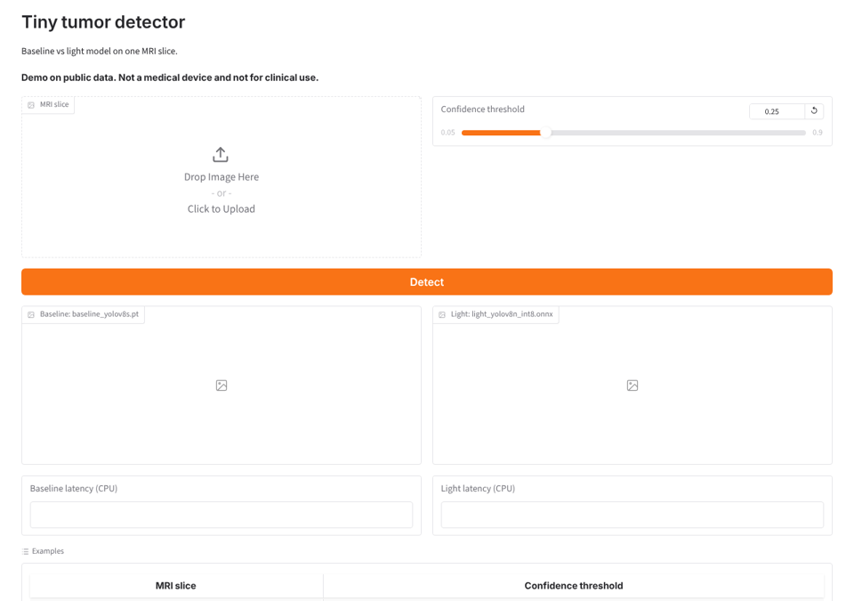
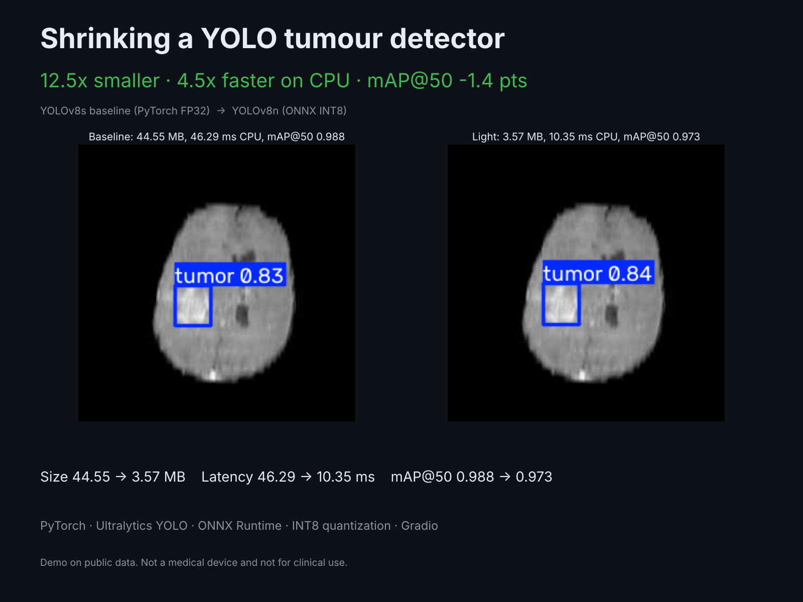
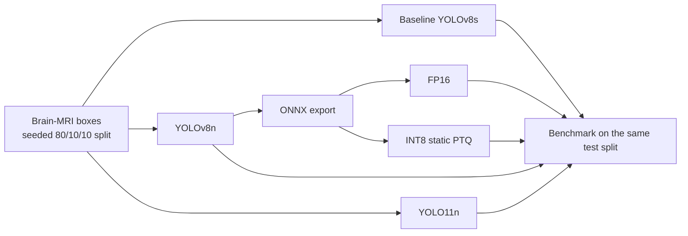
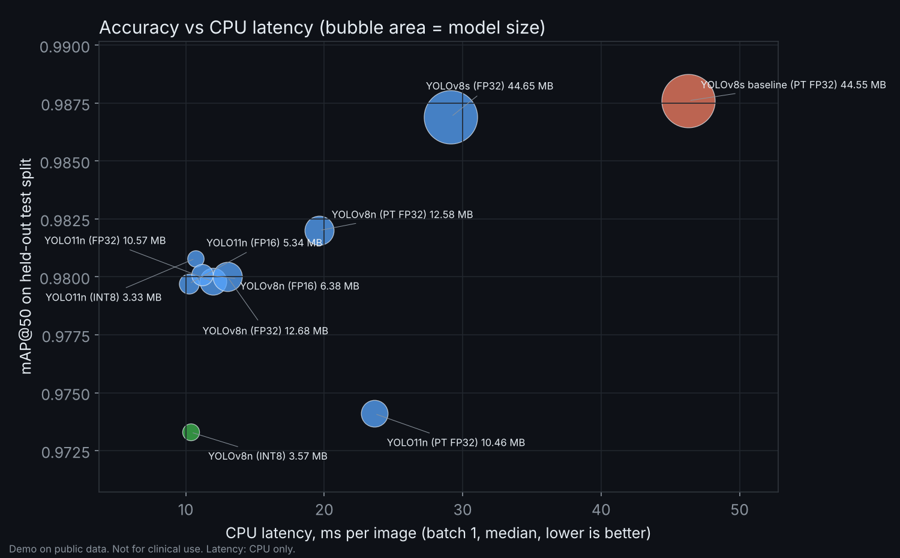
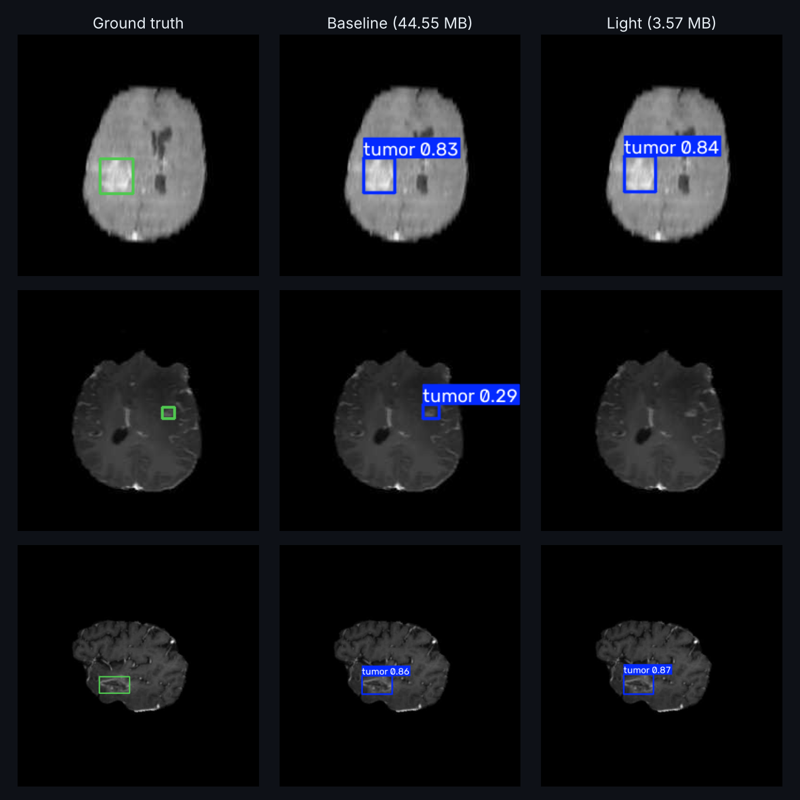

# tiny-tumor-detector

**YOLOv8s tumour detector shrunk to a YOLOv8n INT8 model: 12.5x smaller (44.55 MB -> 3.57 MB), 4.5x faster on CPU (46.29 ms -> 10.35 ms), mAP@50 0.988 -> 0.973 (-1.4 points).** All numbers are measured in this repo (`results/benchmark.csv`).

> Demo on public data. Not a medical device and not for clinical use.





## The problem

Heavy detectors are too large and slow for edge boxes and clinical-workstation CPUs. The usual ask: keep the detection quality, cut size and latency.

## Approach



1. `data/prepare.py` builds one fixed split (seed 0). The source ships only train/val, so all 1115 images are pooled and re-split 80/10/10; files named `<patient>_<slice>.jpg` stay together in one split.
2. `train_baseline.py` trains YOLOv8s; `train_light.py` trains YOLOv8n and YOLO11n with identical settings.
3. `compress.py` exports the chosen light model (YOLOv8n, picked on the **validation** split, not the test split) to ONNX, FP16 and INT8 (ONNX Runtime static quantization, 128 training images as calibration set). The detect-head decode ops and final 1x1 convs are kept in float, because quantizing them gave 0 mAP (box coordinates are in pixels).
4. `benchmark.py` scores every variant on the same 110-image test split.

A mobile-backbone detector (torchvision SSDLite-MobileNetV3) was not trained: it needs its own training loop and evaluation code, which did not fit the CPU-only time budget and would have made the comparison less like-for-like. The two light candidates are therefore two nano YOLO variants.

## Results

Test split: 110 images, 118 tumour boxes, image size 416. Source: `results/benchmark.md` / `results/benchmark.csv`.

| Model | Params (M) | Size (MB) | GFLOPs | mAP@50 | mAP@50-95 | Tumour recall | CPU ms (median) | GPU ms | Peak RAM (MB) |
|---|---|---|---|---|---|---|---|---|---|
| YOLOv8s baseline (PyTorch FP32) | 11.13 | 44.55 | 12.01 | 0.988 | 0.730 | 0.922 | 46.29 | not measured | 484 |
| YOLOv8n (PyTorch FP32) | 3.13 | 12.58 | 3.65 | 0.982 | 0.705 | 0.924 | 19.63 | not measured | 434 |
| YOLO11n (PyTorch FP32) | 2.6 | 10.46 | 2.7 | 0.974 | 0.700 | 0.907 | 23.62 | not measured | 447 |
| YOLOv8s (ONNX FP32) | 11.13 | 44.65 | 12.01 | 0.987 | 0.728 | 0.902 | 29.15 | not measured | 196 |
| YOLO11n (ONNX FP32) | 2.6 | 10.57 | 2.7 | 0.980 | 0.695 | 0.924 | 11.97 | not measured | 130 |
| YOLO11n (ONNX FP16) | 2.6 | 5.34 | 2.7 | 0.980 | 0.692 | 0.924 | 10.22 | not measured | 140 |
| YOLO11n (ONNX INT8) | 2.6 | 3.33 | 2.7 | 0.981 | 0.698 | 0.932 | 10.7 | not measured | 103 |
| YOLOv8n (ONNX FP32) | 3.13 | 12.68 | 3.65 | 0.980 | 0.704 | 0.922 | 13.01 | not measured | 121 |
| YOLOv8n (ONNX FP16) | 3.13 | 6.38 | 3.65 | 0.980 | 0.706 | 0.922 | 11.2 | not measured | 134 |
| **YOLOv8n (ONNX INT8)** | 3.13 | 3.57 | 3.65 | 0.973 | 0.690 | 0.915 | 10.35 | not measured | 99 |





How to read this honestly:

- **Headline pair:** YOLOv8s PyTorch FP32 vs YOLOv8n ONNX INT8. Size 12.5x smaller, 3.6x fewer parameters, 3.3x fewer GFLOPs, 4.5x lower CPU latency, peak RAM 484 -> 99 MB.
- **Part of the speed-up is the runtime, not the model.** Against the baseline exported to ONNX FP32 (29.15 ms), the light INT8 model is 2.8x faster.
- **Accuracy cost:** mAP@50 -1.4 points (0.988 -> 0.973), mAP@50-95 -4.1 points (0.730 -> 0.690), tumour recall -0.7 points (0.922 -> 0.915). In the before/after image the light model misses the small tumour in row 2 that the baseline finds at confidence 0.29. The 3 images were picked with a fixed seed, not hand-selected.
- The test split is small (110 images, 118 boxes), so differences of about a point between variants are within noise. Variants were evaluated on the same split, but there is a single training run per model (no seeds repeated).
- YOLO11n INT8 scored higher on test (mAP@50 0.981) than YOLOv8n INT8. YOLOv8n was kept as the headline model because it won on the validation split (0.984 vs 0.981); choosing on test would leak.
- mAP numbers are high for every model: this dataset is small and visually easy, and file names without a patient id give no way to rule out near-duplicate slices across splits. Treat absolute accuracy as optimistic; the relative comparison is the point.
- **GPU latency: not measured (no GPU available).**
- Latency: Intel Xeon @ 2.10GHz (`/proc/cpuinfo` model name), 4 threads (`torch.set_num_threads(4)` / ORT `intra_op_num_threads=4`), batch 1, forward pass only (no pre/post-processing), median of 150 runs after 10 warm-up runs, variants timed interleaved. The machine was shared with other jobs (load average 3.03 at start), so absolute milliseconds will be noisier than on a quiet machine; an earlier run of the same script gave medians within about 2% of these. Peak RAM is the peak resident set of a fresh process that loads the model and runs 20 inferences.
- The Gradio app shows end-to-end time (pre-process + inference + post-process, one run), so its numbers are not comparable with the benchmark table.

### Training settings

CPU only, 4 cores shared with other jobs. Image size 416, 25 epochs, batch 16, seed 0, pretrained COCO weights, Ultralytics default augmentation and optimizer. Wall time: YOLOv8n 1840 s, YOLO11n 1625 s, YOLOv8s 3432 s (about 1.9 h in total). Per-model validation metrics are in `results/train_*.json`. More epochs or a larger image size would likely raise absolute accuracy.

## What I'd do for your project

- **Profile on your real hardware** (CPU model, RAM, batch size, camera or DICOM pipeline) to find where the time goes before touching the model.
- **Choose the architecture and input size** against your accuracy floor, using a fixed held-out set and the same metric code for every candidate, as done here.
- **Quantize and export for your runtime**: ONNX Runtime, TensorRT, Core ML or TFLite, with calibration on your data and a check that nothing silently collapsed (the naive INT8 export here scored 0 mAP until the head was kept in float).

## Run it

```bash
pip install -r requirements.txt
python data/prepare.py                       # downloads data, writes datasets/brain-tumor, prints class counts
./run_all_training.sh                        # or: python train_light.py && python train_baseline.py  (EPOCHS=25 by default)
python compress.py --weights weights/light_yolov8n.pt --name light_yolov8n
python compress.py --weights weights/light_yolo11n.pt --name light_yolo11n
python compress.py --weights weights/baseline_yolov8s.pt --name baseline_yolov8s
python benchmark.py                          # writes results/benchmark.csv and .md
python make_assets.py && python make_demo_gif.py   # charts, cover, gif (gif needs node + playwright)
python app.py                                # Gradio demo on http://localhost:7860
```

Weights are not committed (`*.pt`, `*.onnx`, `runs/` and `datasets/` are gitignored); the commands above reproduce them. Training is not bit-for-bit deterministic across machines, so expect small differences from the table.

Docker (the image does not contain weights; mount the `weights/` folder produced above):

```bash
docker build -t tiny-tumor-detector .
docker run -p 7860:7860 -v "$PWD/weights:/app/weights" tiny-tumor-detector
```

The image was built and started in the development sandbox with the weights mounted, and the app answered HTTP 200. That sandbox sits behind a TLS-intercepting proxy, so the build used a temporary copy of the Dockerfile with an extra CA certificate, HTTPS apt sources and host networking; the committed Dockerfile is the plain version and was not built unmodified. The side-by-side inference inside the container was not exercised through a browser (only the page load was checked); the same `app.py` was driven end to end outside Docker to record the GIF.

## Dataset and license

[Ultralytics Brain Tumor detection dataset](https://docs.ultralytics.com/datasets/detect/brain-tumor/): 1115 brain MRI slices, one class (`tumor`), YOLO-format boxes, downloaded from the [Ultralytics assets release](https://github.com/ultralytics/assets/releases/download/v0.0.0/brain-tumor.zip). The dataset docs and the archive's `LICENSE.txt` state **AGPL-3.0**, which permits redistribution and demos, so three test images are included in `assets/examples/` and in the generated figures. My split: 891 train / 114 val / 110 test images (940 / 122 / 118 boxes), see `results/dataset_split.txt`.

## Disclaimer

Demo on public data. Not a medical device and not for clinical use. No claim is made about diagnostic performance.

## License

AGPL-3.0 (see `LICENSE`), because the code uses [Ultralytics](https://github.com/ultralytics/ultralytics), which is AGPL-3.0.

Need a model shrunk for your hardware? Hire me on Upwork: https://www.upwork.com/freelancers/~014d8e815fea10ea82
